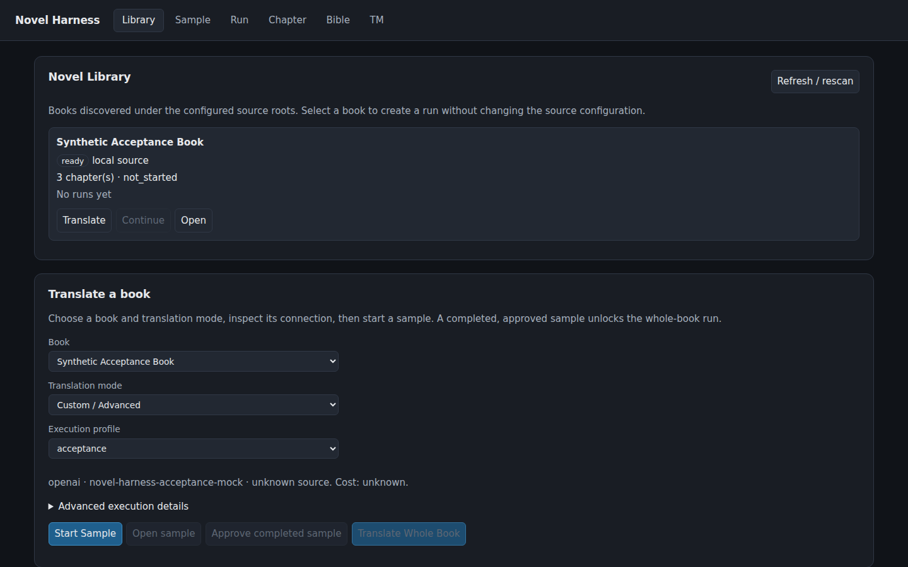
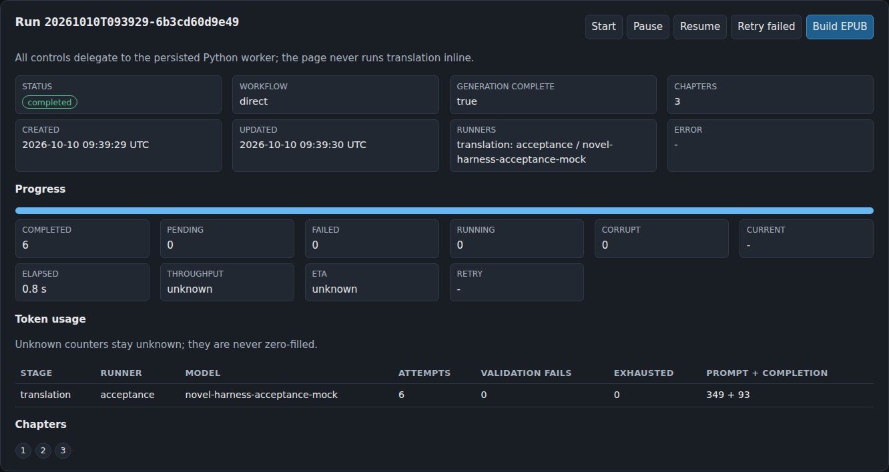
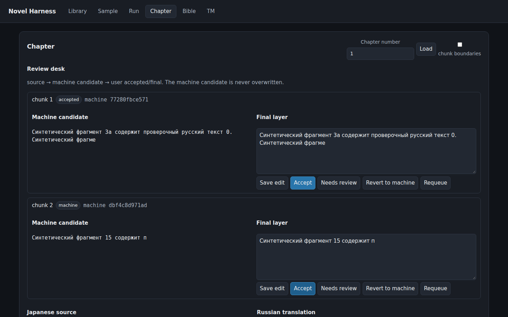
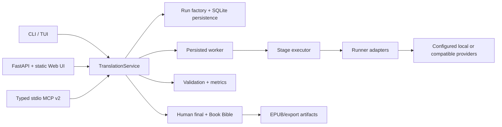

# Novel Harness

**A local-first orchestration and evaluation platform for long-form LLM translation.**

The current product scope is Japanese → Russian. Novel Harness keeps a
machine candidate, a human final layer, provenance, and resumable work separate
inside one persisted service, so a translation run stays inspectable from setup
through EPUB export.

It includes a Web UI, CLI, REST/FastAPI, TUI, and typed stdio MCP v2 surface.
Runs persist in SQLite, workers can pause/resume and recover, and sample-first
approval keeps a whole-book launch explicit.

The deterministic local acceptance path exercised those interfaces and recorded
zero external model requests and tokens. That is orchestration evidence, not a
claim about literary quality.



*Library and sample-first translation workflow running against the same persisted
service used by CLI, REST, TUI, and MCP.*

## Why Novel Harness

Long-form translation needs more than a single request: it needs frozen inputs,
recoverable execution, source-aligned review, and a clear boundary between
machine output and human decisions. Novel Harness is a developer-facing control
plane for those concerns, with local-first execution and explicit provider
configuration.

## What it does

- Discovers a source novel, selects a translation profile, and runs a bounded
  sample before whole-book execution.
- Persists run manifests, chapter/chunk progress, usage, validation, retries,
  and safe execution provenance in SQLite-backed artifacts.
- Presents machine candidates beside an editable human final layer in the
  Review Desk; accepted or revised text can be rebuilt into EPUB.
- Exposes the same `TranslationService` through Web/REST, CLI, TUI, and MCP.

## Workflow

`Library → Sample → Approval → Whole Book → Review → EPUB`

The Web UI keeps this flow visible without hiding the power-user controls. The
run dashboard shows status, workflow, chapters, runner/model identity, progress,
chunk counters, token usage, and the EPUB build action.



*A completed synthetic run with persisted progress, usage, and export controls.*



*Machine candidate and human final layers remain separate while each chunk can
be accepted, edited, marked for review, reverted, or requeued.*

## Benchmark snapshot

Novel Harness was used to compare saved translations from multiple local and
cloud model configurations. The public comparison covers five source chapters,
10 purposively selected diagnostic fragments, 100 saved candidate translations,
and 10 variants. Labels were anonymized during scoring; this was AI evaluation,
not independent human evaluation.

| Variant | Quality | Naturalness | Preferred | Major defects | Minor defects | Cost (USD) |
| --- | ---: | ---: | ---: | ---: | ---: | ---: |
| GLM-5.3-flash | **3.8** | 3.5 | 2 | 1 | 4 | 0.1836 |
| Codex / GPT-6 Luna | 3.7 | **4.7** | 3 | 4 | 2 | — |
| DeepSeek v4-pro | 3.6 | 3.9 | 2 | 4 | 0 | 0.3850 |
| DeepSeek v4.1-flash | 3.5 | 3.1 | 1 | 2 | 4 | 0.1212 |
| Longcat 2.5 preview free | 3.2 | 3.5 | 1 | 4 | 4 | 0.0000 |
| MiMo v2.6-flash | 3.0 | 2.8 | 0 | 7 | 5 | 0.0275 |
| Qwen3.8-27B R / xhigh | 3.0 | 2.8 | 0 | 6 | 2 | — |
| Qwen3.8-flash | 2.9 | 3.6 | 0 | 7 | 3 | 0.1558 |
| Space Bunny | 2.7 | 3.5 | 1 | 11 | 6 | 0.0000 |
| Qwen3.8-27B B / no-thinking | 2.3 | 2.6 | 0 | 13 | 5 | — |

The bold values mark the highest saved quality and naturalness separately; they
are not an overall winner. Costs are shown where the saved evidence supports a
comparable five-chapter estimate.

### Local Qwen profile experiment

The separate local Qwen experiment recorded B, R, PR, and T reasoning/sampling
profiles. On the saved comparison sample, R scored above B, while B used fewer
completion tokens and remained useful as a practical draft profile. The public
profile notes record PR and T's settings without inventing aggregate scores for
them: [Local Qwen profile notes](docs/benchmarks/local-qwen.md).

These experiments use the same persisted orchestration and evaluation
infrastructure. Novel Harness exposes OpenAI-compatible direct, OpenCode, and
Codex runner adapters, so models and execution strategies can be evaluated
through one run and provenance system. The published table is a model/
configuration comparison, not a controlled harness-only benchmark.

The saved evidence is available in the [full 10-variant benchmark](docs/benchmarks/model-comparison.md)
and machine-readable [summary.json](docs/benchmarks/summary.json). The
fragments were diagnostic and purposively selected, not a held-out random
benchmark; small score differences are not statistical significance claims;
Codex/Luna used different saved chunk geometry; and prices were frozen at the
experiment date. These results are not book-wide literary-quality claims.

## Architecture



Every interface delegates to the same service and persisted state. A run
freezes source and prompt hashes, chunk inventory, pipeline, runner identity,
and safe execution settings. Workers commit chunks atomically and resume from
persisted artifacts. Human-final text is never the machine candidate.

See [architecture](docs/architecture.md) for the responsibility map.

## Interfaces

- **Web / REST:** `novel serve` serves the static control/review UI and
  FastAPI API.
- **CLI:** library discovery, launch, status, resume, retry, review, metrics,
  and export.
- **TUI:** terminal library and progress views with bounded worker controls.
- **MCP:** typed stdio JSON-RPC v2 tools for books, profiles, samples, runs,
  review, connections, and export.

## Reliability and provenance

Runs carry source/prompt hashes, chunk inventory, requested and resolved model
identity, decoding settings, usage metrics, and artifact hashes. Credentials
and raw provider configuration are excluded. Unknown identity or missing
material provenance fails closed where it affects reproducibility.

The acceptance result is deliberately bounded:

> application orchestration acceptance != translation quality evaluation

The deterministic local mock exercised Web, CLI, REST, MCP, TUI, persistence,
recovery, and desktop visual paths. It recorded `external_llm_requests = 0`
and `external_llm_tokens = 0`. This proves orchestration behavior, not model
quality, provider reliability, or literary quality.

## Quick start

Python 3.12+ is required:

```bash
python -m venv .venv
source .venv/bin/activate
python -m pip install -e '.[dev,web]'
novel --help
novel runners
```

Copy a portable configuration example, put a small UTF-8 chapter under its
configured source directory, and set a model and OpenAI-compatible endpoint
only when making a provider call. Credentials are referenced by environment
variable name and never stored in provenance.

```bash
novel --config config.quality.example.yaml library list --json
novel --config config.quality.example.yaml serve
```

See the [quickstart](docs/quickstart.md), [configuration](docs/configuration.md),
[MCP/API](docs/mcp.md), and [provenance](docs/provenance.md) guides.

## Verification

CI is offline with mocked providers:

```bash
python -m pytest
python -m ruff check src tests
uv build --out-dir dist
```

No real model inference, provider authentication, private source book, or LAN
endpoint is required by CI.

## Limits

Novel Harness currently targets Japanese → Russian and does not claim arbitrary
language support, mobile usability, WCAG certification, provider reliability,
or literary-quality production certification. Real books, generated
translations, credentials, databases, and run directories are local inputs and
are not part of this repository.

## License

MIT. See [LICENSE](LICENSE).
