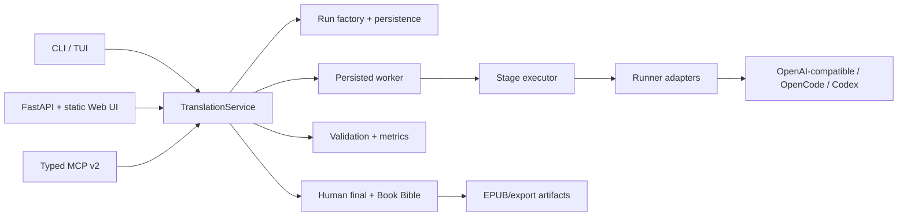

# Architecture

`TranslationService` is the application facade for every interface in the
current Japanese → Russian product scope. Adapters
validate input and delegate; they do not create a second translation engine.
The run factory freezes source and prompt hashes, chunk inventory, pipeline,
runner configuration, decoding settings, and safe execution identity. Workers
commit chunk results atomically and resume from the frozen manifest.

Credentials and raw external configuration are excluded from provenance.
Human-final text and machine output remain separate layers.
